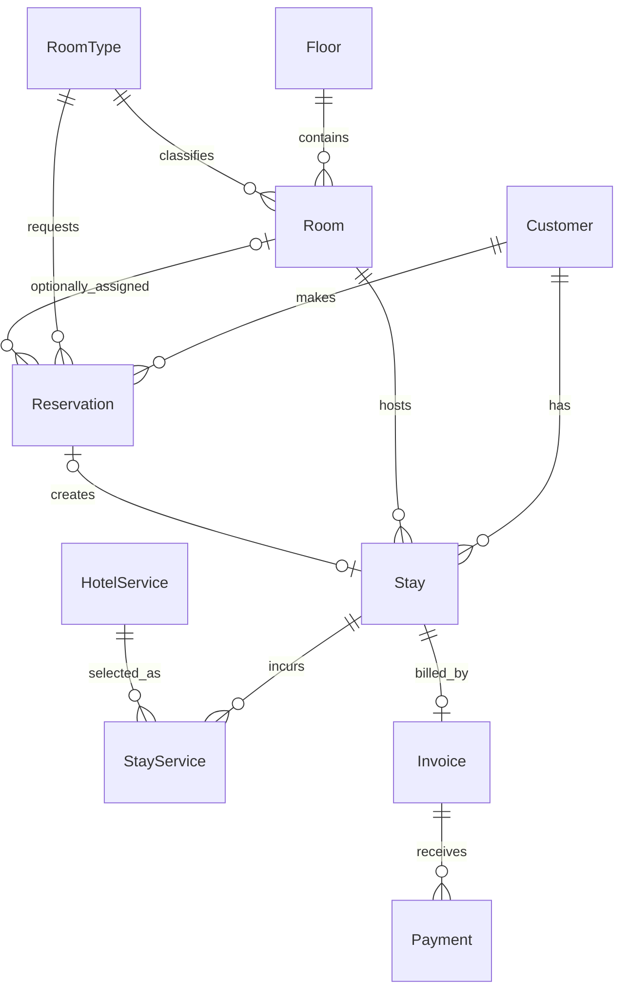

# MÔ TẢ ENTITY – HOTEL MANAGEMENT

> **Phiên bản:** ADO.NET + POCO Entity + SQLite  
> **Project chứa Entity:** `src/HotelManagement.Core`  
> **Namespace:** `HotelManagement.Core.Entities` và `HotelManagement.Core.Enums`  
> **Số Entity:** 10  
> **Số Enum:** 9  
> **CSDL:** `HotelManagementDb.sqlite`
>
> Tài liệu này mô tả các class Entity và Enum hiện có trong source code, đồng thời đối chiếu với schema SQLite tại `database/02_CreateTables.sql` và `database/03_CreateConstraintsAndIndexes.sql`. Đây là hợp đồng dữ liệu dùng chung cho cả nhóm. Không tự ý đổi tên class, property, kiểu dữ liệu, giá trị enum hoặc quan hệ nếu chưa thống nhất.

---

## 1. Mục đích và nguyên tắc thiết kế

### 1.1. Entity là gì?

Entity là class C# thuần (POCO – Plain Old CLR Object) đại diện cho một đối tượng nghiệp vụ hoặc một bản ghi trong Database. Entity chỉ chứa dữ liệu và không phụ thuộc vào WinForms, `MessageBox`, `SqliteConnection` hoặc câu lệnh SQL.

Ví dụ: `Room` biểu diễn một phòng trong khách sạn; `Stay` biểu diễn một lượt lưu trú thực tế; `Invoice` biểu diễn hóa đơn đã chốt cho một lượt lưu trú.

### 1.2. Quy tắc chung

- Mỗi Entity tương ứng với một bảng SQLite cùng tên.
- Namespace Entity: `HotelManagement.Core.Entities`.
- Namespace Enum: `HotelManagement.Core.Enums`.
- Khóa chính hiện tại dùng `int` trong C# và `INTEGER PRIMARY KEY AUTOINCREMENT` trong SQLite.
- Khóa ngoại dùng `int` hoặc `int?` nếu quan hệ được phép không có.
- Property không bắt buộc dùng kiểu nullable như `string?`, `int?`, `DateTime?`.
- Tiền VND dùng `decimal` trong C#, nhưng lưu `INTEGER` trong SQLite theo đơn vị đồng nguyên. Phải chuyển đổi bằng `SqliteValueConverter`; không truyền trực tiếp decimal vào cột tiền.
- `StayService.Quantity` dùng `decimal` trong C# và lưu thành `TEXT` invariant trong SQLite để giữ phần thập phân.
- Ngày giờ dùng `DateTime` trong C# và `TEXT` trong SQLite. Dữ liệu seed và giá trị mặc định hiện dùng dạng `yyyy-MM-dd HH:mm:ss` theo giờ địa phương.
- `bool` trong C# được lưu bằng `INTEGER` (`0` hoặc `1`).
- Enum được lưu bằng `TEXT` đúng tên thành viên enum, ví dụ `Available`, `InProgress`, `CCCD`; không lưu số thứ tự enum.
- Không thêm Navigation Property chứa toàn bộ Entity khác nếu chưa có nhu cầu. Khi cần dữ liệu liên kết cho giao diện, Repository có thể dùng `JOIN` và trả DTO.
- Danh mục đã được sử dụng nên ngừng hoạt động bằng `IsActive`, không xóa cứng.

### 1.3. Phân biệt Entity, DTO, Service và Repository

| Thành phần | Trách nhiệm | Ví dụ |
|---|---|---|
| Entity | Mô tả dữ liệu nghiệp vụ/bản ghi | `Room`, `Customer`, `Stay` |
| Enum | Giới hạn tập giá trị hợp lệ | `RoomStatus`, `StayStatus` |
| DTO | Gom dữ liệu phục vụ một màn hình hoặc kết quả truy vấn | `RoomDashboardDto` (khi triển khai) |
| Service | Kiểm tra quy tắc và điều phối nghiệp vụ | `RoomService`, `CheckInService` |
| Repository | Thực thi SQL, đọc dữ liệu và ánh xạ thành Entity/DTO | `RoomRepository` |

Luồng bắt buộc:

```text
WinForms Form / UserControl
        ↓
Service (nghiệp vụ + validation)
        ↓
Repository / DataAccess
        ↓ ADO.NET – Microsoft.Data.Sqlite
SQLite Database (HotelManagementDb.sqlite)
```

---

## 2. Tổng quan 10 Entity

| STT | Entity | Bảng SQLite | Vai trò chính |
|---:|---|---|---|
| 1 | `Floor` | `Floor` | Lưu tầng của khách sạn. |
| 2 | `RoomType` | `RoomType` | Lưu loại phòng, sức chứa và giá giờ/ngày. |
| 3 | `Room` | `Room` | Lưu từng phòng vật lý và trạng thái vận hành. |
| 4 | `Customer` | `Customer` | Lưu hồ sơ khách hàng do lễ tân nhập. |
| 5 | `Reservation` | `Reservation` | Lưu đặt phòng trước. |
| 6 | `Stay` | `Stay` | Lưu lượt lưu trú thực tế được tạo khi check-in. |
| 7 | `HotelService` | `HotelService` | Lưu danh mục dịch vụ nội bộ. |
| 8 | `StayService` | `StayService` | Lưu từng khoản dịch vụ phát sinh của một lượt lưu trú. |
| 9 | `Invoice` | `Invoice` | Lưu kết quả tính tiền và trạng thái hóa đơn của một Stay. |
| 10 | `Payment` | `Payment` | Lưu giao dịch thanh toán mô phỏng nội bộ. |

### 2.1. Sơ đồ quan hệ



### 2.2. Giải thích quan hệ

- Một `Floor` có nhiều `Room`; mỗi `Room` thuộc đúng một `Floor`.
- Một `RoomType` có nhiều `Room`; mỗi `Room` thuộc đúng một `RoomType`.
- Một `Customer` có thể tạo nhiều `Reservation` và có nhiều `Stay` theo thời gian.
- Một `Reservation` luôn thuộc một `Customer` và một `RoomType`; `RoomId` có thể `null` nếu khách chỉ đặt theo loại phòng, chưa gán phòng cụ thể.
- Một `Reservation` có thể chưa check-in hoặc tạo tối đa một `Stay`. Index lọc `UX_Stay_Reservation` bảo đảm một `ReservationId` khác `NULL` không xuất hiện ở hai Stay.
- Một `Stay` thuộc một `Customer`, một `Room`, và có thể liên kết đến một `Reservation` hoặc là khách vãng lai (`ReservationId = null`).
- Một `Stay` có nhiều `StayService` và tối đa một `Invoice` (`Invoice.StayId` là `UNIQUE`).
- Một `HotelService` có thể được sử dụng nhiều lần qua nhiều bản ghi `StayService`.
- Một `Invoice` có thể có nhiều `Payment` theo cấu trúc hiện tại. Trong quy trình MVP thông thường chỉ ghi một giao dịch thanh toán; schema hiện tại chưa đặt `UNIQUE` trên `Payment.InvoiceId`, vì vậy không được giả định Database đã chặn nhiều Payment cho cùng Invoice.

---

## 3. Chi tiết các Entity

## 3.1. `Floor` – Tầng

**File:** `Entities/Floor.cs`  
**Bảng:** `Floor`

**Mục đích:** Lưu danh sách tầng để phân nhóm phòng trong màn hình S01 và bộ lọc tầng trong các màn hình quản lý phòng.

| Property C# | Kiểu C# | Cột SQLite | Null? | Mô tả |
|---|---|---|---|---|
| `FloorId` | `int` | `FloorId INTEGER PRIMARY KEY AUTOINCREMENT` | Không | Khóa chính tự tăng. |
| `FloorNumber` | `int` | `FloorNumber INTEGER NOT NULL UNIQUE` | Không | Số tầng; không được trùng. |
| `FloorName` | `string` | `FloorName TEXT NOT NULL` | Không | Tên hiển thị, ví dụ `Tầng 1`. |
| `SortOrder` | `int` | `SortOrder INTEGER NOT NULL DEFAULT 0` | Không | Thứ tự sắp xếp khi hiển thị. |
| `IsActive` | `bool` | `IsActive INTEGER NOT NULL DEFAULT 1` | Không | `1`: đang sử dụng; `0`: ngừng sử dụng. DB có CHECK chỉ nhận 0/1. |

**Quan hệ:** `Floor` 1 – N `Room`.

**Quy tắc:**

- Không tạo hai tầng có cùng `FloorNumber`.
- Tầng đã có phòng không xóa cứng; dùng `IsActive = false`.
- Bộ lọc tầng của S01 chỉ nên hiển thị các tầng đang hoạt động.

---

## 3.2. `RoomType` – Loại phòng

**File:** `Entities/RoomType.cs`  
**Bảng:** `RoomType`

**Mục đích:** Định nghĩa nhóm phòng, sức chứa tối đa và bảng giá theo giờ/ngày.

| Property C# | Kiểu C# | Cột SQLite | Null? | Mô tả |
|---|---|---|---|---|
| `RoomTypeId` | `int` | `RoomTypeId INTEGER PRIMARY KEY AUTOINCREMENT` | Không | Khóa chính tự tăng. |
| `TypeCode` | `string` | `TypeCode TEXT NOT NULL UNIQUE` | Không | Mã loại phòng, ví dụ `STD`, `DLX`. |
| `TypeName` | `string` | `TypeName TEXT NOT NULL` | Không | Tên loại phòng để hiển thị. |
| `Description` | `string?` | `Description TEXT NULL` | Có | Mô tả loại phòng. |
| `MaxOccupancy` | `int` | `MaxOccupancy INTEGER NOT NULL CHECK (> 0)` | Không | Sức chứa tối đa. |
| `HourlyRate` | `decimal` | `HourlyRate INTEGER NOT NULL CHECK (>= 0)` | Không | Giá thuê theo giờ, đơn vị VND. |
| `DailyRate` | `decimal` | `DailyRate INTEGER NOT NULL CHECK (>= 0)` | Không | Giá thuê theo ngày, đơn vị VND. |
| `IsActive` | `bool` | `IsActive INTEGER NOT NULL DEFAULT 1` | Không | Còn kinh doanh hay đã ngừng. |

**Quan hệ:**

- Một `RoomType` có nhiều `Room`.
- Một `RoomType` có thể được tham chiếu bởi nhiều `Reservation`.

**Quy tắc:**

- `TypeCode` không được trùng.
- `MaxOccupancy > 0`.
- Giá giờ/ngày không âm.
- Khi check-in, số khách thực tế không được vượt `MaxOccupancy` của loại phòng.
- Khi tạo Stay, sao chép `HourlyRate` và `DailyRate` sang `Stay.HourlyRateAtCheckIn` và `Stay.DailyRateAtCheckIn`. Không đọc giá hiện tại để tính lại hóa đơn lịch sử.

---

## 3.3. `Room` – Phòng

**File:** `Entities/Room.cs`  
**Bảng:** `Room`

**Mục đích:** Đại diện cho một phòng vật lý trong khách sạn. Đây là dữ liệu chính của sơ đồ phòng S01.

| Property C# | Kiểu C# | Cột SQLite | Null? | Mô tả |
|---|---|---|---|---|
| `RoomId` | `int` | `RoomId INTEGER PRIMARY KEY AUTOINCREMENT` | Không | Khóa chính tự tăng. |
| `RoomCode` | `string` | `RoomCode TEXT NOT NULL UNIQUE` | Không | Mã phòng, ví dụ `101`, `201`. |
| `FloorId` | `int` | `FloorId INTEGER NOT NULL` | Không | Khóa ngoại đến `Floor.FloorId`. |
| `RoomTypeId` | `int` | `RoomTypeId INTEGER NOT NULL` | Không | Khóa ngoại đến `RoomType.RoomTypeId`. |
| `Status` | `RoomStatus` | `Status TEXT NOT NULL DEFAULT 'Available'` | Không | Trạng thái vận hành hiện tại. |
| `Note` | `string?` | `Note TEXT NULL` | Có | Ghi chú phòng. |
| `IsActive` | `bool` | `IsActive INTEGER NOT NULL DEFAULT 1` | Không | Phòng còn được đưa vào kinh doanh hay không. |

**Khóa ngoại:**

- `FloorId` → `Floor.FloorId`, `ON DELETE RESTRICT`.
- `RoomTypeId` → `RoomType.RoomTypeId`, `ON DELETE RESTRICT`.

**Quan hệ:**

- Nhiều phòng thuộc một tầng.
- Nhiều phòng thuộc một loại phòng.
- Một phòng có thể được gán vào nhiều Reservation ở các khoảng thời gian khác nhau.
- Một phòng có nhiều Stay trong lịch sử; Service phải ngăn hai Stay đang hoạt động cùng chiếm một phòng.

**Trạng thái:**

| Giá trị `RoomStatus` | Màu trên Dashboard | Ý nghĩa |
|---|---|---|
| `Available` | Xanh lá | Phòng sẵn sàng nhận khách. |
| `Reserved` | Cam | Phòng đã được gán cho Reservation còn hiệu lực. |
| `Occupied` | Đỏ | Phòng đang có khách lưu trú. |
| `Cleaning` | Vàng | Khách đã checkout; phòng đang chờ dọn xong. |

**Quy tắc:**

- Không tự ý chuyển phòng sang `Occupied` hoặc `Reserved` bằng thao tác sửa danh mục thông thường. Hai trạng thái này phải phát sinh từ nghiệp vụ check-in/đặt phòng.
- Phòng `Cleaning` không được check-in.
- Chỉ gán `Reserved` khi Reservation có `RoomId` cụ thể. Reservation chỉ giữ chỗ theo loại phòng không làm đổi trạng thái phòng vật lý.
- Hoàn tất dọn phòng: chuyển sang `Reserved` nếu còn Reservation hợp lệ được gán phòng; nếu không thì `Available`.
- Phòng đã có lịch sử không xóa cứng; dùng `IsActive = false` nếu ngừng kinh doanh.

---

## 3.4. `Customer` – Khách hàng

**File:** `Entities/Customer.cs`  
**Bảng:** `Customer`

**Mục đích:** Lưu hồ sơ khách do lễ tân nhập. Không có tài khoản khách hàng, đăng nhập hoặc xác minh giấy tờ trực tuyến.

| Property C# | Kiểu C# | Cột SQLite | Null? | Mô tả |
|---|---|---|---|---|
| `CustomerId` | `int` | `CustomerId INTEGER PRIMARY KEY AUTOINCREMENT` | Không | Khóa chính tự tăng. |
| `FullName` | `string` | `FullName TEXT NOT NULL` | Không | Họ và tên khách. |
| `IdentityType` | `IdentityType` | `IdentityType TEXT NOT NULL` | Không | Loại giấy tờ: `CCCD` hoặc `Passport`. |
| `IdentityNumber` | `string` | `IdentityNumber TEXT NOT NULL` | Không | Số CCCD/hộ chiếu. |
| `Phone` | `string` | `Phone TEXT NOT NULL` | Không | Số điện thoại liên hệ. |
| `Email` | `string?` | `Email TEXT NULL` | Có | Email; không bắt buộc. |
| `Address` | `string?` | `Address TEXT NULL` | Có | Địa chỉ; không bắt buộc. |
| `CreatedAt` | `DateTime` | `CreatedAt TEXT NOT NULL` | Không | Thời điểm tạo hồ sơ; mặc định thời gian địa phương của SQLite. |
| `IsActive` | `bool` | `IsActive INTEGER NOT NULL DEFAULT 1` | Không | Hồ sơ đang hoạt động hay đã ngừng sử dụng. |

**Ràng buộc:** `UNIQUE (IdentityType, IdentityNumber)` – không lưu trùng cùng một số giấy tờ cùng loại.

**Quan hệ:**

- Một Customer có thể có nhiều Reservation.
- Một Customer có thể có nhiều Stay theo thời gian.

**Quy tắc:**

- Tìm khách theo số giấy tờ, điện thoại hoặc tên trước khi tạo hồ sơ mới.
- Không kết nối dịch vụ xác minh CCCD/hộ chiếu bên ngoài.
- Không xóa khách đã có Reservation/Stay; có thể ngừng hoạt động bằng `IsActive = false`.

---

## 3.5. `Reservation` – Đặt phòng

**File:** `Entities/Reservation.cs`  
**Bảng:** `Reservation`

**Mục đích:** Lưu yêu cầu đặt phòng trước. Nhân viên lễ tân nhập dữ liệu trực tiếp; khách không tự đặt phòng qua website hoặc API.

| Property C# | Kiểu C# | Cột SQLite | Null? | Mô tả |
|---|---|---|---|---|
| `ReservationId` | `int` | `ReservationId INTEGER PRIMARY KEY AUTOINCREMENT` | Không | Khóa chính tự tăng. |
| `ReservationCode` | `string` | `ReservationCode TEXT NOT NULL UNIQUE` | Không | Mã đặt phòng duy nhất. |
| `CustomerId` | `int` | `CustomerId INTEGER NOT NULL` | Không | Khóa ngoại đến khách đặt phòng. |
| `RoomTypeId` | `int` | `RoomTypeId INTEGER NOT NULL` | Không | Loại phòng khách yêu cầu. |
| `RoomId` | `int?` | `RoomId INTEGER NULL` | Có | Phòng vật lý được giữ trước; `null` nếu chỉ đặt theo loại. |
| `ExpectedCheckIn` | `DateTime` | `ExpectedCheckIn TEXT NOT NULL` | Không | Thời điểm dự kiến đến. |
| `ExpectedCheckOut` | `DateTime` | `ExpectedCheckOut TEXT NOT NULL` | Không | Thời điểm dự kiến đi. |
| `DepositAmount` | `decimal` | `DepositAmount INTEGER NOT NULL DEFAULT 0` | Không | Tiền cọc thực tế đã nhận, đơn vị VND. |
| `Note` | `string?` | `Note TEXT NULL` | Có | Ghi chú đặt phòng. |
| `Status` | `ReservationStatus` | `Status TEXT NOT NULL DEFAULT 'Confirmed'` | Không | Trạng thái đặt phòng. |
| `CreatedAt` | `DateTime` | `CreatedAt TEXT NOT NULL` | Không | Thời điểm tạo đặt phòng. |

**Khóa ngoại:**

- `CustomerId` → `Customer.CustomerId`, `ON DELETE RESTRICT`.
- `RoomTypeId` → `RoomType.RoomTypeId`, `ON DELETE RESTRICT`.
- `RoomId` → `Room.RoomId`, `ON DELETE SET NULL`.

**Quan hệ:** một Reservation thuộc một Customer và một RoomType; có thể gán một Room cụ thể; một Reservation tạo tối đa một Stay.

**Quy tắc:**

- `ExpectedCheckOut > ExpectedCheckIn`.
- `DepositAmount >= 0`.
- Nếu `RoomId = null`, Reservation chỉ giữ chỗ theo loại phòng; không đổi trạng thái phòng nào thành `Reserved`.
- Nếu `RoomId` có giá trị, phòng phải đúng loại và không bị trùng lịch với Reservation/Stay khác.
- Khi chuyển sang check-in, tạo Stay gắn `ReservationId` và cập nhật Reservation sang `CheckedIn` trong cùng transaction.
- Hủy đặt phòng chuyển `Status = Cancelled`; không xóa cứng.

---

## 3.6. `Stay` – Lượt lưu trú

**File:** `Entities/Stay.cs`  
**Bảng:** `Stay`

**Mục đích:** Ghi nhận một lượt khách ở thực tế. Đây là đối tượng trung tâm dùng để ghi nhận dịch vụ, checkout và lập hóa đơn.

| Property C# | Kiểu C# | Cột SQLite | Null? | Mô tả |
|---|---|---|---|---|
| `StayId` | `int` | `StayId INTEGER PRIMARY KEY AUTOINCREMENT` | Không | Khóa chính tự tăng. |
| `ReservationId` | `int?` | `ReservationId INTEGER NULL` | Có | Reservation nguồn; `null` với khách vãng lai. |
| `CustomerId` | `int` | `CustomerId INTEGER NOT NULL` | Không | Khóa ngoại đến khách đang lưu trú. |
| `RoomId` | `int` | `RoomId INTEGER NOT NULL` | Không | Khóa ngoại đến phòng thực tế. |
| `ActualCheckIn` | `DateTime` | `ActualCheckIn TEXT NOT NULL` | Không | Thời điểm check-in thực tế. |
| `ExpectedCheckOut` | `DateTime` | `ExpectedCheckOut TEXT NOT NULL` | Không | Thời điểm dự kiến checkout. |
| `ActualCheckOut` | `DateTime?` | `ActualCheckOut TEXT NULL` | Có | Thời điểm checkout thực tế; chưa checkout thì `null`. |
| `GuestCount` | `int` | `GuestCount INTEGER NOT NULL` | Không | Số khách thực tế trong phòng. |
| `HourlyRateAtCheckIn` | `decimal` | `HourlyRateAtCheckIn INTEGER NOT NULL` | Không | Giá giờ được chụp tại thời điểm check-in, đơn vị VND. |
| `DailyRateAtCheckIn` | `decimal` | `DailyRateAtCheckIn INTEGER NOT NULL` | Không | Giá ngày được chụp tại thời điểm check-in, đơn vị VND. |
| `Status` | `StayStatus` | `Status TEXT NOT NULL DEFAULT 'InProgress'` | Không | Trạng thái lượt lưu trú. |
| `Note` | `string?` | `Note TEXT NULL` | Có | Ghi chú lượt lưu trú. |

**Khóa ngoại:**

- `ReservationId` → `Reservation.ReservationId`, `ON DELETE RESTRICT`.
- `CustomerId` → `Customer.CustomerId`, `ON DELETE RESTRICT`.
- `RoomId` → `Room.RoomId`, `ON DELETE RESTRICT`.

**Index/Unique:** index `UX_Stay_Reservation` là unique có điều kiện `ReservationId IS NOT NULL`, giúp một Reservation chỉ tạo tối đa một Stay. Các index `IX_Stay_Room_Status` và `IX_Stay_Customer` hỗ trợ tra cứu.

**Quy tắc:**

- `GuestCount > 0`.
- `ExpectedCheckOut > ActualCheckIn`.
- `ActualCheckOut` nếu có phải lớn hơn hoặc bằng `ActualCheckIn`.
- Số khách không vượt `RoomType.MaxOccupancy`; đây là kiểm tra nghiệp vụ Service vì cần đọc RoomType.
- Một phòng không được có hai Stay `InProgress` đồng thời. Source hiện có index tra cứu theo Room/Status; Service phải kiểm tra và dùng transaction để bảo đảm quy tắc này.
- Khi check-in, sao chép hai mức giá từ RoomType sang Stay để bảo toàn lịch sử giá.
- Chỉ Stay `InProgress` được ghi dịch vụ mới.
- Checkout được xác nhận thanh toán: Stay chuyển `CheckoutPending`; sau khi in mô phỏng: Stay chuyển `Completed`.

---

## 3.7. `HotelService` – Danh mục dịch vụ

**File:** `Entities/HotelService.cs`  
**Bảng:** `HotelService`

**Mục đích:** Lưu những dịch vụ nội bộ có thể tính phí cho khách. Không tích hợp đối tác thuê xe, giặt ủi hoặc nhà hàng.

| Property C# | Kiểu C# | Cột SQLite | Null? | Mô tả |
|---|---|---|---|---|
| `ServiceId` | `int` | `ServiceId INTEGER PRIMARY KEY AUTOINCREMENT` | Không | Khóa chính tự tăng. |
| `ServiceCode` | `string` | `ServiceCode TEXT NOT NULL UNIQUE` | Không | Mã dịch vụ duy nhất. |
| `ServiceName` | `string` | `ServiceName TEXT NOT NULL` | Không | Tên dịch vụ. |
| `Category` | `ServiceCategory` | `Category TEXT NOT NULL` | Không | Nhóm dịch vụ. |
| `UnitName` | `string` | `UnitName TEXT NOT NULL` | Không | Đơn vị tính: chai, lon, kg, lượt,... |
| `UnitPrice` | `decimal` | `UnitPrice INTEGER NOT NULL` | Không | Đơn giá hiện tại, đơn vị VND. |
| `Description` | `string?` | `Description TEXT NULL` | Có | Mô tả dịch vụ. |
| `IsActive` | `bool` | `IsActive INTEGER NOT NULL DEFAULT 1` | Không | Còn cung cấp hay đã ngừng. |

**Nhóm dịch vụ (`ServiceCategory`):** `FoodDrink`, `Laundry`, `Transport`, `Other`.

**Quan hệ:** một HotelService có thể được tham chiếu bởi nhiều StayService.

**Quy tắc:**

- `ServiceCode` không trùng.
- `UnitPrice >= 0`.
- Khi dịch vụ đã được sử dụng trong lịch sử, không xóa cứng; dùng `IsActive = false`.
- `Transport` chỉ là khoản dịch vụ nhân viên ghi nhận thủ công; không kết nối nhà cung cấp hoặc đối tác.

---

## 3.8. `StayService` – Dịch vụ phát sinh trong lượt lưu trú

**File:** `Entities/StayService.cs`  
**Bảng:** `StayService`

**Mục đích:** Lưu một dòng dịch vụ khách sử dụng trong một lượt Stay. Mỗi lần sử dụng có thể tạo một bản ghi riêng.

| Property C# | Kiểu C# | Cột SQLite | Null? | Mô tả |
|---|---|---|---|---|
| `StayServiceId` | `int` | `StayServiceId INTEGER PRIMARY KEY AUTOINCREMENT` | Không | Khóa chính tự tăng. |
| `StayId` | `int` | `StayId INTEGER NOT NULL` | Không | Khóa ngoại đến lượt lưu trú. |
| `ServiceId` | `int` | `ServiceId INTEGER NOT NULL` | Không | Khóa ngoại đến danh mục dịch vụ. |
| `Quantity` | `decimal` | `Quantity TEXT NOT NULL` | Không | Số lượng dùng; lưu dạng text invariant để giữ phần thập phân. |
| `UnitPrice` | `decimal` | `UnitPrice INTEGER NOT NULL` | Không | Đơn giá được chụp tại thời điểm dùng, đơn vị VND. |
| `Amount` | `decimal` | `Amount INTEGER NOT NULL` | Không | Thành tiền đã tính và lưu, đơn vị VND. |
| `UsedAt` | `DateTime` | `UsedAt TEXT NOT NULL` | Không | Thời điểm sử dụng; mặc định thời gian địa phương của SQLite. |
| `Note` | `string?` | `Note TEXT NULL` | Có | Ghi chú dòng dịch vụ. |

**Khóa ngoại:**

- `StayId` → `Stay.StayId`, `ON DELETE RESTRICT`.
- `ServiceId` → `HotelService.ServiceId`, `ON DELETE RESTRICT`.

**Index:** `IX_StayService_Stay_UsedAt` hỗ trợ lấy các khoản dịch vụ theo Stay và thời điểm sử dụng.

**Quy tắc:**

- Chỉ Stay `InProgress` được thêm dịch vụ.
- `Quantity > 0`, `UnitPrice >= 0`.
- `Amount = Quantity × UnitPrice`; Service tính và lưu thành tiền.
- `UnitPrice` phải lấy từ HotelService tại thời điểm thêm và không thay đổi khi giá danh mục được cập nhật sau này.
- StayService không tự xóa khi đổi giá dịch vụ; dữ liệu lịch sử được giữ nguyên.

---

## 3.9. `Invoice` – Hóa đơn

**File:** `Entities/Invoice.cs`  
**Bảng:** `Invoice`

**Mục đích:** Chốt số tiền của một lượt lưu trú, gồm tiền phòng, tiền dịch vụ, tiền cọc được trừ và số tiền cần thu/hoàn.

| Property C# | Kiểu C# | Cột SQLite | Null? | Mô tả |
|---|---|---|---|---|
| `InvoiceId` | `int` | `InvoiceId INTEGER PRIMARY KEY AUTOINCREMENT` | Không | Khóa chính tự tăng. |
| `InvoiceCode` | `string` | `InvoiceCode TEXT NOT NULL UNIQUE` | Không | Mã hóa đơn duy nhất. |
| `StayId` | `int` | `StayId INTEGER NOT NULL UNIQUE` | Không | Khóa ngoại đến Stay; mỗi Stay tối đa một Invoice. |
| `CreatedAt` | `DateTime` | `CreatedAt TEXT NOT NULL` | Không | Thời điểm lập hóa đơn. |
| `ChargeBasis` | `ChargeBasis` | `ChargeBasis TEXT NOT NULL` | Không | Cách tính tiền phòng: `Hour` hoặc `Day`. |
| `ChargedUnits` | `int` | `ChargedUnits INTEGER NOT NULL` | Không | Số giờ/ngày tính tiền sau làm tròn; phải > 0. |
| `AppliedRate` | `decimal` | `AppliedRate INTEGER NOT NULL` | Không | Đơn giá được áp dụng, đơn vị VND. |
| `RoomCharge` | `decimal` | `RoomCharge INTEGER NOT NULL` | Không | Tiền phòng. |
| `ServiceCharge` | `decimal` | `ServiceCharge INTEGER NOT NULL` | Không | Tổng tiền dịch vụ. |
| `SubTotal` | `decimal` | `SubTotal INTEGER NOT NULL` | Không | Tổng trước khi trừ cọc: RoomCharge + ServiceCharge. |
| `DepositDeducted` | `decimal` | `DepositDeducted INTEGER NOT NULL` | Không | Số tiền cọc được trừ vào hóa đơn. |
| `AmountDue` | `decimal` | `AmountDue INTEGER NOT NULL` | Không | Số tiền khách cần thanh toán thêm. |
| `RefundDue` | `decimal` | `RefundDue INTEGER NOT NULL` | Không | Số tiền cần hoàn nếu tiền cọc lớn hơn chi phí. |
| `Status` | `InvoiceStatus` | `Status TEXT NOT NULL DEFAULT 'Unpaid'` | Không | Trạng thái hóa đơn. |
| `PrintedAt` | `DateTime?` | `PrintedAt TEXT NULL` | Có | Thời điểm hoàn tất thao tác in mô phỏng. |

**Ràng buộc SQLite:**

- `InvoiceCode` là duy nhất.
- `StayId` là duy nhất và tham chiếu `Stay.StayId`.
- `ChargedUnits > 0`; các trường tiền không âm.
- `SubTotal = RoomCharge + ServiceCharge`.
- `DepositDeducted <= SubTotal`.
- `Status` chỉ nhận `Unpaid` hoặc `Paid`.

**Quan hệ:** một Invoice thuộc đúng một Stay; một Stay có tối đa một Invoice. Invoice có thể có nhiều Payment theo cấu trúc bảng Payment hiện tại.

**Công thức tính tiền:**

Gọi `H` là tổng số giờ lưu trú thực tế, làm tròn lên đến giờ nguyên gần nhất.

- Nếu `ChargeBasis = Hour`: `ChargedUnits = max(1, ceil(H))`; `RoomCharge = ChargedUnits × HourlyRateAtCheckIn`.
- Nếu `ChargeBasis = Day`: `ChargedUnits = max(1, ceil(H / 24))`; `RoomCharge = ChargedUnits × DailyRateAtCheckIn`.
- `ServiceCharge = tổng Amount của StayService thuộc Stay`.
- `SubTotal = RoomCharge + ServiceCharge`.
- `DepositAmount` lấy từ Reservation nếu Stay có Reservation; khách vãng lai không có Reservation thì tiền cọc mặc định bằng 0.
- `DepositDeducted = min(DepositAmount, SubTotal)`.
- `AmountDue = max(0, SubTotal - DepositAmount)`.
- `RefundDue = max(0, DepositAmount - SubTotal)`.

**Luồng trạng thái:** sau khi xác nhận thanh toán mô phỏng, Invoice chuyển `Paid`; Stay chuyển `CheckoutPending`. Sau khi bấm In mô phỏng, cập nhật `PrintedAt`, Stay chuyển `Completed`, Reservation liên quan chuyển `Completed`, Room chuyển `Cleaning`.

> Chi tiết các dòng dịch vụ được lấy từ `StayService` theo `StayId`; không cần bảng `InvoiceDetail` riêng trong phạm vi MVP.

---

## 3.10. `Payment` – Giao dịch thanh toán mô phỏng

**File:** `Entities/Payment.cs`  
**Bảng:** `Payment`

**Mục đích:** Ghi nhận việc lễ tân xác nhận thanh toán trong ứng dụng offline. Đây là bản ghi nội bộ, không đại diện giao dịch ngân hàng hoặc cổng thanh toán.

| Property C# | Kiểu C# | Cột SQLite | Null? | Mô tả |
|---|---|---|---|---|
| `PaymentId` | `int` | `PaymentId INTEGER PRIMARY KEY AUTOINCREMENT` | Không | Khóa chính tự tăng. |
| `InvoiceId` | `int` | `InvoiceId INTEGER NOT NULL` | Không | Khóa ngoại đến hóa đơn. |
| `PaymentCode` | `string` | `PaymentCode TEXT NOT NULL UNIQUE` | Không | Mã giao dịch nội bộ duy nhất. |
| `Amount` | `decimal` | `Amount INTEGER NOT NULL` | Không | Số tiền được xác nhận thu; phải > 0. |
| `Method` | `PaymentMethod` | `Method TEXT NOT NULL` | Không | `Cash` hoặc `Simulated`. |
| `Status` | `PaymentStatus` | `Status TEXT NOT NULL DEFAULT 'Completed'` | Không | Hiện chỉ có `Completed`. |
| `PaidAt` | `DateTime` | `PaidAt TEXT NOT NULL` | Không | Thời điểm xác nhận thanh toán. |
| `Note` | `string?` | `Note TEXT NULL` | Có | Ghi chú giao dịch. |

**Khóa ngoại:** `InvoiceId` → `Invoice.InvoiceId`, `ON DELETE RESTRICT`.

**Ràng buộc SQLite:**

- `PaymentCode` là duy nhất.
- `Amount > 0`.
- `Method` chỉ nhận `Cash` hoặc `Simulated`.
- `Status` hiện chỉ nhận `Completed`.
- Có index `IX_Payment_Invoice_PaidAt` trên `(InvoiceId, PaidAt)`.

**Quan hệ và giới hạn hiện tại:** một Invoice có thể có nhiều Payment theo schema vì `Payment.InvoiceId` chưa có ràng buộc UNIQUE. MVP dự kiến thường chỉ tạo một Payment cho khoản phải thu; nếu nhóm muốn Database bắt buộc một Payment cho mỗi Invoice thì phải thống nhất và bổ sung unique index trong migration/schema, không được mô tả rằng ràng buộc đó đã tồn tại.

Nếu `Invoice.AmountDue = 0`, có thể hoàn tất hóa đơn mà không tạo Payment có Amount bằng 0 vì schema hiện yêu cầu `Amount > 0`.

---

## 4. Enum dùng chung

Các Enum nằm trong `src/HotelManagement.Core/Enums/`. Khi lưu xuống SQLite, dùng đúng tên thành viên enum dạng chuỗi; không tự chuyển sang số hoặc tự đổi cách viết.

### 4.1. `RoomStatus`

**File:** `Enums/RoomStatus.cs`

| Giá trị | Ý nghĩa | Màu Dashboard |
|---|---|---|
| `Available` | Phòng sạch, sẵn sàng nhận khách. | Xanh lá |
| `Reserved` | Phòng đã được gán cho Reservation còn hiệu lực. | Cam |
| `Occupied` | Phòng đang có khách. | Đỏ |
| `Cleaning` | Phòng đang chờ dọn xong sau checkout. | Vàng |

### 4.2. `ReservationStatus`

**File:** `Enums/ReservationStatus.cs`

| Giá trị | Ý nghĩa |
|---|---|
| `Confirmed` | Đặt phòng được lưu và còn hiệu lực. |
| `CheckedIn` | Khách đã nhận phòng từ Reservation này. |
| `Completed` | Lượt đặt phòng đã hoàn tất checkout. |
| `Cancelled` | Đặt phòng đã hủy. |
| `NoShow` | Khách không đến; có trong enum/schema hiện tại nhưng không bắt buộc triển khai luồng riêng trong MVP. |

### 4.3. `StayStatus`

**File:** `Enums/StayStatus.cs`

| Giá trị | Ý nghĩa |
|---|---|
| `InProgress` | Khách đang lưu trú; có thể ghi nhận dịch vụ và checkout. |
| `CheckoutPending` | Đã xác nhận thanh toán; chờ in mô phỏng để hoàn tất; không cho ghi dịch vụ mới. |
| `Completed` | Đã hoàn tất checkout và thao tác in mô phỏng. |

### 4.4. `IdentityType`

**File:** `Enums/IdentityType.cs`

- `CCCD`: Căn cước công dân.
- `Passport`: Hộ chiếu.

### 4.5. `ServiceCategory`

**File:** `Enums/ServiceCategory.cs`

| Giá trị | Ý nghĩa |
|---|---|
| `FoodDrink` | Đồ ăn/đồ uống. |
| `Laundry` | Giặt ủi. |
| `Transport` | Khoản dịch vụ vận chuyển/thuê xe do nhân viên ghi nhận thủ công; không kết nối đối tác. |
| `Other` | Dịch vụ nội bộ khác. |

### 4.6. `InvoiceStatus`

**File:** `Enums/InvoiceStatus.cs`

- `Unpaid`: Hóa đơn chưa xác nhận thanh toán.
- `Paid`: Đã xác nhận thanh toán mô phỏng.

### 4.7. `ChargeBasis`

**File:** `Enums/ChargeBasis.cs`

- `Hour`: Tính tiền phòng theo giờ.
- `Day`: Tính tiền phòng theo ngày.

### 4.8. `PaymentMethod`

**File:** `Enums/PaymentMethod.cs`

- `Cash`: Xác nhận thu tiền mặt tại quầy.
- `Simulated`: Giao dịch thanh toán mô phỏng nội bộ; không gọi cổng thanh toán.

### 4.9. `PaymentStatus`

**File:** `Enums/PaymentStatus.cs`

- `Completed`: Giao dịch mô phỏng đã được ghi nhận hoàn tất.

---

## 5. Ánh xạ kiểu dữ liệu C# sang SQLite

SQLite sử dụng hệ kiểu lưu trữ linh hoạt. Để cả nhóm đọc/ghi dữ liệu nhất quán, áp dụng quy ước cụ thể sau:

| Kiểu C# | Kiểu SQLite trong schema hiện tại | Quy tắc |
|---|---|---|
| `int` | `INTEGER` | Dùng cho ID, số tầng, số lượng nguyên và số đơn vị tính tiền. |
| `string` / `string?` | `TEXT` | Chuỗi Unicode; property nullable tương ứng cột `NULL`. |
| `bool` | `INTEGER` | `0 = false`, `1 = true`; cột IsActive có CHECK. |
| `DateTime` / `DateTime?` | `TEXT` | Lưu theo định dạng thống nhất; không trộn chuỗi ngày giờ tùy ý. |
| `decimal` dùng cho tiền VND | `INTEGER` | Lưu số đồng nguyên; chuyển đổi qua `SqliteValueConverter`. |
| `decimal` của `Quantity` | `TEXT` | Lưu chuỗi invariant để giữ phần thập phân; chuyển đổi qua `SqliteValueConverter`. |
| Enum | `TEXT` | Lưu tên thành viên enum, ví dụ `Available`, `Unpaid`, `CCCD`. |

### 5.1. `SqliteValueConverter`

File hiện tại: `src/HotelManagement.Infrastructure/Data/SqliteValueConverter.cs`.

| Phương thức | Công dụng |
|---|---|
| `ToVnd(decimal amount)` | Chỉ chấp nhận số tiền nguyên đồng và chuyển thành `long` để lưu SQLite `INTEGER`. Nếu có phần thập phân thì ném lỗi. |
| `FromVnd(SqliteDataReader reader, int ordinal)` | Đọc giá trị INTEGER và trả về `decimal` trong Entity. |
| `ToDecimalText(decimal value)` | Chuyển decimal thành chuỗi invariant để lưu `Quantity` dạng TEXT. |
| `FromDecimalText(SqliteDataReader reader, int ordinal)` | Đọc chuỗi và parse về decimal invariant. |

**Không làm:**

- Không dùng `double`/`REAL` để tính tiền.
- Không nối chuỗi số theo Culture hiện tại của máy (ví dụ dùng dấu phẩy thập phân tùy ngôn ngữ).
- Không ghi giá trị decimal trực tiếp vào cột tiền INTEGER mà bỏ qua converter.

### 5.2. Ngày giờ

- Schema hiện dùng `TEXT` cho các cột ngày giờ.
- Seed data và default SQLite đang dùng dạng `yyyy-MM-dd HH:mm:ss` theo giờ địa phương.
- Repository phải dùng cùng quy tắc chuyển đổi khi ghi và đọc `DateTime`.
- Không trộn giờ UTC và giờ địa phương trong cùng một cột nếu chưa có quy ước chuyển đổi rõ ràng.

---

## 6. Ràng buộc, khóa ngoại và Index hiện tại

### 6.1. Ràng buộc khai báo trong `02_CreateTables.sql`

| Bảng | Ràng buộc |
|---|---|
| `Floor` | `FloorNumber` UNIQUE; `IsActive` chỉ nhận 0/1. |
| `RoomType` | `TypeCode` UNIQUE; `MaxOccupancy > 0`; giá giờ/ngày không âm; `IsActive` chỉ nhận 0/1. |
| `Room` | `RoomCode` UNIQUE; Status chỉ nhận bốn trạng thái; FK đến Floor và RoomType; `IsActive` chỉ nhận 0/1. |
| `Customer` | IdentityType chỉ nhận `CCCD`/`Passport`; UNIQUE cặp `(IdentityType, IdentityNumber)`; `IsActive` chỉ nhận 0/1. |
| `Reservation` | `ReservationCode` UNIQUE; tiền cọc không âm; ExpectedCheckOut > ExpectedCheckIn; Status thuộc tập đã chốt; FK Customer/RoomType/Room. |
| `Stay` | GuestCount > 0; giá chụp tại check-in không âm; ExpectedCheckOut > ActualCheckIn; ActualCheckOut không trước ActualCheckIn; Status thuộc tập đã chốt; FK Reservation/Customer/Room. |
| `HotelService` | `ServiceCode` UNIQUE; Category thuộc tập đã chốt; UnitPrice không âm; `IsActive` chỉ nhận 0/1. |
| `StayService` | Quantity > 0; UnitPrice và Amount không âm; FK Stay/HotelService. |
| `Invoice` | InvoiceCode UNIQUE; StayId UNIQUE; ChargedUnits > 0; các số tiền không âm; SubTotal = RoomCharge + ServiceCharge; DepositDeducted <= SubTotal; Status Unpaid/Paid; FK Stay. |
| `Payment` | PaymentCode UNIQUE; Amount > 0; Method Cash/Simulated; Status Completed; FK Invoice. |

### 6.2. Khóa ngoại và hành vi xóa

- Các FK phần lớn dùng `ON DELETE RESTRICT` để không xóa bản ghi đang được lịch sử nghiệp vụ tham chiếu.
- Riêng `Reservation.RoomId` dùng `ON DELETE SET NULL`: nếu Room bị xóa vật lý thì Reservation giữ lại nhưng bỏ liên kết phòng. Tuy vậy, quy tắc nghiệp vụ vẫn ưu tiên ngừng hoạt động bằng `IsActive` thay vì xóa.
- `DbConnectionFactory` phải bật `ForeignKeys = true` cho mỗi kết nối. Nếu tắt Foreign Keys, SQLite sẽ không thực thi các quan hệ như mong muốn.

### 6.3. Index trong `03_CreateConstraintsAndIndexes.sql`

| Index | Bảng/cột | Mục đích |
|---|---|---|
| `IX_Room_Floor_Status` | Room `(FloorId, Status, IsActive)` | Lọc phòng theo tầng, trạng thái và hoạt động. |
| `IX_Room_RoomType` | Room `(RoomTypeId)` | Lọc phòng theo loại. |
| `IX_Reservation_Room_Time_Status` | Reservation `(RoomId, ExpectedCheckIn, ExpectedCheckOut, Status)` | Kiểm tra và tra cứu lịch đặt phòng theo phòng/thời gian. |
| `IX_Reservation_Customer_CheckIn` | Reservation `(CustomerId, ExpectedCheckIn)` | Tra cứu đặt phòng theo khách và ngày đến. |
| `UX_Stay_Reservation` | Stay `(ReservationId)` WHERE ReservationId IS NOT NULL | Một Reservation tạo tối đa một Stay. |
| `IX_Stay_Room_Status` | Stay `(RoomId, Status)` | Tìm Stay theo phòng và trạng thái. |
| `IX_Stay_Customer` | Stay `(CustomerId)` | Tra cứu lịch sử lưu trú theo khách. |
| `IX_StayService_Stay_UsedAt` | StayService `(StayId, UsedAt)` | Lấy dịch vụ theo Stay và thời gian. |
| `IX_Invoice_Status_CreatedAt` | Invoice `(Status, CreatedAt)` | Lọc hóa đơn theo trạng thái và ngày tạo. |
| `IX_Payment_Invoice_PaidAt` | Payment `(InvoiceId, PaidAt)` | Tra cứu giao dịch theo hóa đơn và thời gian. |

### 6.4. Các quy tắc cần kiểm tra trong Service

Không phải mọi quy tắc đều được thể hiện bằng CHECK/UNIQUE của SQLite. Service phải chịu trách nhiệm cho:

- Kiểm tra đặt phòng trùng khoảng thời gian trên cùng một Room.
- Kiểm tra số phòng còn khả dụng khi Reservation chỉ gán RoomType mà chưa có RoomId.
- Kiểm tra không có hai Stay `InProgress` trên cùng một Room.
- Kiểm tra số khách không vượt sức chứa RoomType.
- Chỉ cho thêm dịch vụ khi Stay `InProgress`.
- Kiểm tra Room/RoomType/Floor/HotelService đang hoạt động trước khi sử dụng.
- Tính tiền, tiền cọc, số tiền cần thu và tiền hoàn theo công thức đã thống nhất.
- Cập nhật đồng bộ Reservation/Stay/Room/Invoice/Payment trong transaction khi nghiệp vụ liên quan nhiều bảng.

Hai khoảng thời gian giao nhau khi:

```text
ExistingStart < NewEnd AND ExistingEnd > NewStart
```

Không dùng riêng `Room.Status` để kết luận phòng không có lịch đặt trong tương lai; phải truy vấn Reservation và Stay.

---

## 7. Quy trình sử dụng Entity theo nghiệp vụ

### 7.1. Tạo Reservation

1. Tìm hoặc tạo `Customer`.
2. Chọn `RoomType`.
3. Có thể chọn `Room` cụ thể hoặc để `RoomId = null`.
4. Kiểm tra khoảng thời gian hợp lệ và khả dụng.
5. Lưu `Reservation` với `Status = Confirmed`.
6. Nếu đã gán Room cụ thể, cập nhật Room sang `Reserved` khi không có xung đột.

### 7.2. Check-in

1. Chọn Reservation đến hạn hoặc tạo lượt khách vãng lai.
2. Xác nhận Customer, giấy tờ, số khách và Room hợp lệ.
3. Kiểm tra phòng không `Occupied`/`Cleaning`, sức chứa và lịch trùng.
4. Tạo `Stay` với `Status = InProgress`.
5. Sao chép giá giờ/ngày từ RoomType vào Stay.
6. Cập nhật Room thành `Occupied`.
7. Nếu check-in từ Reservation, cập nhật Reservation thành `CheckedIn`.
8. Thực hiện tạo Stay và cập nhật các trạng thái liên quan trong cùng `SqliteTransaction`.

### 7.3. Ghi dịch vụ

1. Nhận `StayId` đang `InProgress`.
2. Chọn `HotelService` đang hoạt động.
3. Nhập Quantity > 0.
4. Sao chép UnitPrice hiện tại vào `StayService.UnitPrice`.
5. Tính Amount = Quantity × UnitPrice.
6. Lưu StayService; không cho ghi thêm nếu Stay đã `CheckoutPending` hoặc `Completed`.

### 7.4. Checkout và lập Invoice

1. Chọn Stay `InProgress` và ghi ActualCheckOut.
2. Chọn cách tính Hour/Day.
3. Tính tiền phòng từ giá đã chụp trong Stay.
4. Tính tổng dịch vụ từ các StayService.
5. Lấy tiền cọc từ Reservation nếu Stay có Reservation; khách vãng lai không có Reservation thì tiền cọc bằng 0.
6. Tạo một Invoice cho Stay; `Invoice.StayId` UNIQUE ngăn lập hóa đơn thứ hai.
7. Khi xác nhận thanh toán mô phỏng, cập nhật Invoice `Paid`, ghi Payment nếu AmountDue > 0 và chuyển Stay sang `CheckoutPending`.
8. Khi in mô phỏng, cập nhật PrintedAt, Stay `Completed`, Reservation `Completed` nếu có, Room `Cleaning`.
9. Các cập nhật nhiều bảng phải được đặt trong transaction phù hợp.

### 7.5. Hoàn tất dọn phòng

1. Chọn Room `Cleaning`.
2. Xác nhận đã dọn xong.
3. Kiểm tra còn Reservation hợp lệ đã gán phòng hay không.
4. Nếu còn, Room chuyển `Reserved`; nếu không, chuyển `Available`.

---

## 8. Quy tắc phối hợp cho các thành viên

1. Không tự ý đổi tên Entity, property, enum hoặc kiểu dữ liệu.
2. Không thêm/xóa cột hoặc đổi quan hệ chỉ trong một nhánh mà không cập nhật tài liệu này và SQL scripts.
3. Khi cần thay đổi schema, cập nhật đồng bộ:
    - `docs/HotelManagement_Entities.md`;
    - các file `database/*.sql` hoặc script migration mới;
    - Entity/Enum trong `HotelManagement.Core`;
    - Repository ánh xạ dữ liệu;
    - Service/validation có liên quan.
4. Không thêm SQL vào Form hoặc Entity.
5. Không tạo Navigation Property chỉ để dễ truy cập dữ liệu; dùng Repository/DTO khi cần kết quả JOIN.
6. Không commit file `.sqlite`, `.sqlite-wal`, `.sqlite-shm` có dữ liệu runtime.
7. Dùng `SqliteValueConverter` khi lưu/đọc tiền VND và Quantity; không tự tạo cách chuyển đổi khác trong từng Repository.
8. Lưu enum đúng tên thành viên đang khai báo trong C# và được CHECK trong schema.

---

## 9. Danh sách file Entity và Enum hiện tại

```text
src/HotelManagement.Core/
├── Entities/
│   ├── Customer.cs
│   ├── Floor.cs
│   ├── HotelService.cs
│   ├── Invoice.cs
│   ├── Payment.cs
│   ├── Reservation.cs
│   ├── Room.cs
│   ├── RoomType.cs
│   ├── Stay.cs
│   └── StayService.cs
└── Enums/
    ├── ChargeBasis.cs
    ├── IdentityType.cs
    ├── InvoiceStatus.cs
    ├── PaymentMethod.cs
    ├── PaymentStatus.cs
    ├── ReservationStatus.cs
    ├── RoomStatus.cs
    ├── ServiceCategory.cs
    └── StayStatus.cs
```

**Nguồn chuẩn khi có khác biệt:** class Entity/Enum hiện được nhóm thống nhất và schema SQLite đang được commit. Nếu một trong hai thay đổi, phải cập nhật nguồn còn lại cùng tài liệu trong một commit/PR; không để code và tài liệu lệch nhau.
