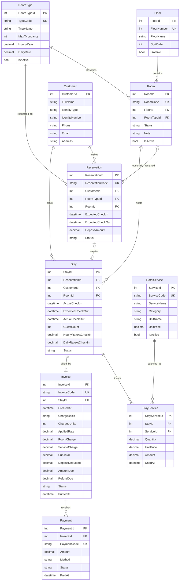

# MÔ TẢ ENTITY – HỆ THỐNG QUẢN LÝ KHÁCH SẠN

> Tài liệu này là hợp đồng dữ liệu chung cho 3 thành viên. Tên Entity, thuộc tính, khóa và enum cần được thống nhất trước khi triển khai Form/Service/Repository.

## 1. Nguyên tắc thiết kế

- Entity là các lớp C# mô tả dữ liệu nghiệp vụ; không chứa mã giao diện WinForms hoặc câu SQL.
- Mỗi Entity tương ứng một bảng SQL Server trong phạm vi thiết kế này.
- Khóa chính dùng `int IDENTITY(1,1)`; các khóa ngoại dùng `int`.
- Tiền VND dùng `decimal` trong C# và `DECIMAL(18,0)` trong SQL Server; không dùng `float` hoặc `double`.
- Ngày giờ dùng `DateTime` trong C# và `DATETIME2` trong SQL Server. Ứng dụng chạy cục bộ theo giờ địa phương.
- Các thuộc tính tùy chọn phải nullable (`string?`, `int?`, `DateTime?`).
- Danh mục đã có lịch sử sử dụng nên dùng `IsActive` để ngừng sử dụng, không xóa cứng.
- `RoomStatus` là trạng thái vận hành của phòng. Phòng `RESERVED` chỉ được đặt khi một Reservation được gán `RoomId` cụ thể.
- Giá phòng được chụp tại thời điểm check-in; giá dịch vụ được chụp tại thời điểm ghi nhận để hóa đơn lịch sử không đổi khi bảng giá được cập nhật.

---

## 2. Sơ đồ quan hệ



> Trong Mermaid, quan hệ `Room o|--o{ Reservation` biểu diễn `Reservation.RoomId` là tùy chọn. Quan hệ Reservation–Stay là 0..1 ở mỗi phía trong phạm vi đồ án: đặt phòng có thể chưa check-in; một đặt phòng chỉ tạo tối đa một lượt Stay.

---

## 3. Danh sách Entity

## 3.1. `Floor` – Tầng

**Mục đích:** lưu các tầng để nhóm phòng trên sơ đồ.

| Thuộc tính C# | Kiểu C# | Cột SQL đề xuất | Bắt buộc | Mô tả |
|---|---|---|---|---|
| `FloorId` | `int` | `FloorId INT IDENTITY` | PK | Khóa chính. |
| `FloorNumber` | `int` | `FloorNumber INT` | Có | Số tầng; không trùng. |
| `FloorName` | `string` | `FloorName NVARCHAR(100)` | Có | Tên hiển thị, ví dụ Tầng 1. |
| `SortOrder` | `int` | `SortOrder INT` | Có | Thứ tự hiển thị. |
| `IsActive` | `bool` | `IsActive BIT` | Có | Còn sử dụng hay không. |

**Quan hệ:** một Floor có nhiều Room.

## 3.2. `RoomType` – Loại phòng

**Mục đích:** định nghĩa loại phòng và bảng giá.

| Thuộc tính C# | Kiểu C# | Cột SQL đề xuất | Bắt buộc | Mô tả |
|---|---|---|---|---|
| `RoomTypeId` | `int` | `RoomTypeId INT IDENTITY` | PK | Khóa chính. |
| `TypeCode` | `string` | `TypeCode VARCHAR(30)` | Có, unique | Mã loại phòng. |
| `TypeName` | `string` | `TypeName NVARCHAR(100)` | Có | Tên loại phòng. |
| `Description` | `string?` | `Description NVARCHAR(500)` | Không | Mô tả. |
| `MaxOccupancy` | `int` | `MaxOccupancy INT` | Có | Sức chứa tối đa. |
| `HourlyRate` | `decimal` | `HourlyRate DECIMAL(18,0)` | Có | Giá theo giờ. |
| `DailyRate` | `decimal` | `DailyRate DECIMAL(18,0)` | Có | Giá theo ngày. |
| `IsActive` | `bool` | `IsActive BIT` | Có | Còn kinh doanh hay không. |

**Quan hệ:** một RoomType có nhiều Room và có thể được chọn trong nhiều Reservation.

## 3.3. `Room` – Phòng

**Mục đích:** lưu thông tin từng phòng thực tế.

| Thuộc tính C# | Kiểu C# | Cột SQL đề xuất | Bắt buộc | Mô tả |
|---|---|---|---|---|
| `RoomId` | `int` | `RoomId INT IDENTITY` | PK | Khóa chính. |
| `RoomCode` | `string` | `RoomCode VARCHAR(20)` | Có, unique | Mã phòng, ví dụ 101. |
| `FloorId` | `int` | `FloorId INT` | FK, có | Tầng của phòng. |
| `RoomTypeId` | `int` | `RoomTypeId INT` | FK, có | Loại phòng. |
| `Status` | `RoomStatus` | `Status VARCHAR(20)` | Có | Trạng thái hiện tại. |
| `Note` | `string?` | `Note NVARCHAR(300)` | Không | Ghi chú. |
| `IsActive` | `bool` | `IsActive BIT` | Có | Phòng còn được đưa vào kinh doanh hay không. |

**Quan hệ:**

- Nhiều Room thuộc một Floor.
- Nhiều Room thuộc một RoomType.
- Một Room có thể xuất hiện trong nhiều Reservation ở các khoảng thời gian khác nhau.
- Một Room có nhiều Stay theo lịch sử, nhưng chỉ có tối đa một Stay `IN_PROGRESS` tại một thời điểm.

**Quy tắc trạng thái:**

- `AVAILABLE`: phòng sẵn sàng nhận khách.
- `RESERVED`: đã gán cho một đặt phòng còn hiệu lực.
- `OCCUPIED`: có Stay đang `IN_PROGRESS`.
- `CLEANING`: đã checkout và chưa xác nhận dọn xong.

## 3.4. `Customer` – Khách hàng

**Mục đích:** lưu hồ sơ khách do nhân viên nhập, dùng chung cho đặt phòng và check-in.

| Thuộc tính C# | Kiểu C# | Cột SQL đề xuất | Bắt buộc | Mô tả |
|---|---|---|---|---|
| `CustomerId` | `int` | `CustomerId INT IDENTITY` | PK | Khóa chính. |
| `FullName` | `string` | `FullName NVARCHAR(150)` | Có | Họ tên. |
| `IdentityType` | `IdentityType` | `IdentityType VARCHAR(20)` | Có | `CCCD` hoặc `PASSPORT`. |
| `IdentityNumber` | `string` | `IdentityNumber VARCHAR(30)` | Có, unique theo loại | Số giấy tờ. |
| `Phone` | `string` | `Phone VARCHAR(20)` | Có | Số điện thoại liên hệ. |
| `Email` | `string?` | `Email VARCHAR(150)` | Không | Email. |
| `Address` | `string?` | `Address NVARCHAR(300)` | Không | Địa chỉ. |
| `CreatedAt` | `DateTime` | `CreatedAt DATETIME2` | Có | Ngày tạo hồ sơ. |
| `IsActive` | `bool` | `IsActive BIT` | Có | Trạng thái hồ sơ. |

**Ràng buộc:** đề xuất tạo unique index trên cặp `(IdentityType, IdentityNumber)` để tránh lưu cùng một giấy tờ nhiều lần.

**Quan hệ:** một Customer có thể có nhiều Reservation và nhiều Stay.

## 3.5. `Reservation` – Đặt phòng

**Mục đích:** lưu yêu cầu đặt phòng trước khi khách nhận phòng.

| Thuộc tính C# | Kiểu C# | Cột SQL đề xuất | Bắt buộc | Mô tả |
|---|---|---|---|---|
| `ReservationId` | `int` | `ReservationId INT IDENTITY` | PK | Khóa chính. |
| `ReservationCode` | `string` | `ReservationCode VARCHAR(30)` | Có, unique | Mã đặt phòng. |
| `CustomerId` | `int` | `CustomerId INT` | FK, có | Khách đặt phòng. |
| `RoomTypeId` | `int` | `RoomTypeId INT` | FK, có | Loại phòng được yêu cầu. |
| `RoomId` | `int?` | `RoomId INT NULL` | FK, không | Phòng cụ thể được giữ trước; null nếu chỉ đặt theo loại. |
| `ExpectedCheckIn` | `DateTime` | `ExpectedCheckIn DATETIME2` | Có | Thời điểm dự kiến đến. |
| `ExpectedCheckOut` | `DateTime` | `ExpectedCheckOut DATETIME2` | Có | Thời điểm dự kiến đi. |
| `DepositAmount` | `decimal` | `DepositAmount DECIMAL(18,0)` | Có | Tiền cọc đã nhận, mặc định 0. |
| `Note` | `string?` | `Note NVARCHAR(500)` | Không | Ghi chú. |
| `Status` | `ReservationStatus` | `Status VARCHAR(20)` | Có | Trạng thái đặt phòng. |
| `CreatedAt` | `DateTime` | `CreatedAt DATETIME2` | Có | Ngày tạo. |

**Quan hệ:**

- Một Reservation thuộc một Customer và một RoomType.
- Có thể được gán một Room cụ thể (`RoomId` nullable).
- Một Reservation chỉ có tối đa một Stay được tạo từ lần check-in.

**Lưu ý quan trọng:** đặt phòng theo loại phòng nhưng chưa gán phòng cụ thể không chuyển bất kỳ Room nào sang `RESERVED`. Khi check-in, nhân viên chọn phòng cùng loại còn trống.

## 3.6. `Stay` – Lượt lưu trú

**Mục đích:** ghi nhận một lần khách thực tế ở tại phòng. Đây là bản ghi trung tâm để ghi dịch vụ và lập hóa đơn.

| Thuộc tính C# | Kiểu C# | Cột SQL đề xuất | Bắt buộc | Mô tả |
|---|---|---|---|---|
| `StayId` | `int` | `StayId INT IDENTITY` | PK | Khóa chính. |
| `ReservationId` | `int?` | `ReservationId INT NULL` | FK, không | Có giá trị nếu check-in từ đặt phòng; null với khách vãng lai. |
| `CustomerId` | `int` | `CustomerId INT` | FK, có | Khách đang lưu trú. |
| `RoomId` | `int` | `RoomId INT` | FK, có | Phòng thực tế được nhận. |
| `ActualCheckIn` | `DateTime` | `ActualCheckIn DATETIME2` | Có | Thời điểm check-in thực tế. |
| `ExpectedCheckOut` | `DateTime` | `ExpectedCheckOut DATETIME2` | Có | Ngày/giờ dự kiến trả phòng; có thể lấy từ Reservation hoặc nhập cho khách vãng lai. |
| `ActualCheckOut` | `DateTime?` | `ActualCheckOut DATETIME2 NULL` | Không | Thời điểm trả phòng thực tế. |
| `GuestCount` | `int` | `GuestCount INT` | Có | Số khách thực tế. |
| `HourlyRateAtCheckIn` | `decimal` | `HourlyRateAtCheckIn DECIMAL(18,0)` | Có | Giá giờ được chụp tại check-in. |
| `DailyRateAtCheckIn` | `decimal` | `DailyRateAtCheckIn DECIMAL(18,0)` | Có | Giá ngày được chụp tại check-in. |
| `Status` | `StayStatus` | `Status VARCHAR(20)` | Có | `IN_PROGRESS`, `CHECKOUT_PENDING` hoặc `COMPLETED`. |
| `Note` | `string?` | `Note NVARCHAR(500)` | Không | Ghi chú. |

**Quan hệ:**

- Một Stay thuộc một Customer và một Room.
- Một Stay có thể xuất phát từ Reservation hoặc là khách vãng lai.
- Một Stay có nhiều StayService và tối đa một Invoice.

**Quy tắc:** chỉ Stay `IN_PROGRESS` mới được ghi thêm dịch vụ hoặc checkout.

## 3.7. `HotelService` – Danh mục dịch vụ

**Mục đích:** định nghĩa các dịch vụ khách sạn có thu phí.

| Thuộc tính C# | Kiểu C# | Cột SQL đề xuất | Bắt buộc | Mô tả |
|---|---|---|---|---|
| `ServiceId` | `int` | `ServiceId INT IDENTITY` | PK | Khóa chính. |
| `ServiceCode` | `string` | `ServiceCode VARCHAR(30)` | Có, unique | Mã dịch vụ. |
| `ServiceName` | `string` | `ServiceName NVARCHAR(150)` | Có | Tên dịch vụ. |
| `Category` | `ServiceCategory` | `Category VARCHAR(30)` | Có | Đồ uống, giặt ủi, thuê xe, khác. |
| `UnitName` | `string` | `UnitName NVARCHAR(30)` | Có | Đơn vị tính: ly, kg, lượt, giờ,... |
| `UnitPrice` | `decimal` | `UnitPrice DECIMAL(18,0)` | Có | Đơn giá hiện tại. |
| `Description` | `string?` | `Description NVARCHAR(300)` | Không | Mô tả. |
| `IsActive` | `bool` | `IsActive BIT` | Có | Còn cung cấp hay không. |

**Quan hệ:** một HotelService có thể xuất hiện trong nhiều StayService.

## 3.8. `StayService` – Dịch vụ phát sinh trong lượt lưu trú

**Mục đích:** lưu chi tiết từng lần khách sử dụng dịch vụ.

| Thuộc tính C# | Kiểu C# | Cột SQL đề xuất | Bắt buộc | Mô tả |
|---|---|---|---|---|
| `StayServiceId` | `int` | `StayServiceId INT IDENTITY` | PK | Khóa chính. |
| `StayId` | `int` | `StayId INT` | FK, có | Lượt lưu trú phát sinh dịch vụ. |
| `ServiceId` | `int` | `ServiceId INT` | FK, có | Dịch vụ được chọn. |
| `Quantity` | `decimal` | `Quantity DECIMAL(18,2)` | Có | Số lượng sử dụng. |
| `UnitPrice` | `decimal` | `UnitPrice DECIMAL(18,0)` | Có | Đơn giá tại thời điểm ghi nhận. |
| `Amount` | `decimal` | `Amount DECIMAL(18,0)` | Có | Thành tiền = Quantity × UnitPrice, được tính và lưu khi ghi nhận. |
| `UsedAt` | `DateTime` | `UsedAt DATETIME2` | Có | Thời điểm phát sinh. |
| `Note` | `string?` | `Note NVARCHAR(300)` | Không | Ghi chú. |

**Quy tắc:** không cập nhật `UnitPrice` theo giá danh mục sau khi đã ghi nhận. Dữ liệu StayService của Stay đã hoàn tất không được sửa trong MVP.

## 3.9. `Invoice` – Hóa đơn

**Mục đích:** chốt tổng chi phí của một lượt lưu trú.

| Thuộc tính C# | Kiểu C# | Cột SQL đề xuất | Bắt buộc | Mô tả |
|---|---|---|---|---|
| `InvoiceId` | `int` | `InvoiceId INT IDENTITY` | PK | Khóa chính. |
| `InvoiceCode` | `string` | `InvoiceCode VARCHAR(30)` | Có, unique | Mã hóa đơn. |
| `StayId` | `int` | `StayId INT` | FK, unique | Một Stay chỉ có tối đa một hóa đơn. |
| `CreatedAt` | `DateTime` | `CreatedAt DATETIME2` | Có | Thời điểm lập hóa đơn. |
| `ChargeBasis` | `ChargeBasis` | `ChargeBasis VARCHAR(10)` | Có | Cách tính tiền phòng: `HOUR` hoặc `DAY`. |
| `ChargedUnits` | `int` | `ChargedUnits INT` | Có | Số giờ/ngày tính tiền sau khi làm tròn. |
| `AppliedRate` | `decimal` | `AppliedRate DECIMAL(18,0)` | Có | Đơn giá giờ/ngày được áp dụng. |
| `RoomCharge` | `decimal` | `RoomCharge DECIMAL(18,0)` | Có | Tiền phòng. |
| `ServiceCharge` | `decimal` | `ServiceCharge DECIMAL(18,0)` | Có | Tổng tiền dịch vụ. |
| `SubTotal` | `decimal` | `SubTotal DECIMAL(18,0)` | Có | RoomCharge + ServiceCharge. |
| `DepositDeducted` | `decimal` | `DepositDeducted DECIMAL(18,0)` | Có | Tiền cọc được trừ. |
| `AmountDue` | `decimal` | `AmountDue DECIMAL(18,0)` | Có | Số tiền khách cần thanh toán thêm. |
| `RefundDue` | `decimal` | `RefundDue DECIMAL(18,0)` | Có | Tiền cần hoàn lại nếu cọc lớn hơn chi phí. |
| `Status` | `InvoiceStatus` | `Status VARCHAR(20)` | Có | `UNPAID` hoặc `PAID`. |
| `PrintedAt` | `DateTime?` | `PrintedAt DATETIME2 NULL` | Không | Thời điểm bấm In mô phỏng. |

**Quan hệ:** một Invoice thuộc một Stay và có thể có nhiều Payment (nếu sau này cho phép thanh toán nhiều lần; MVP chỉ cần một lần).

**Lưu ý:** không cần bảng `InvoiceDetail` riêng trong MVP vì chi tiết dịch vụ được truy xuất từ `StayService`; tiền phòng được lưu trực tiếp trong Invoice.

## 3.10. `Payment` – Giao dịch thanh toán mô phỏng

**Mục đích:** ghi nhận việc lễ tân bấm xác nhận thanh toán trong ứng dụng offline.

| Thuộc tính C# | Kiểu C# | Cột SQL đề xuất | Bắt buộc | Mô tả |
|---|---|---|---|---|
| `PaymentId` | `int` | `PaymentId INT IDENTITY` | PK | Khóa chính. |
| `InvoiceId` | `int` | `InvoiceId INT` | FK, có | Hóa đơn được thanh toán. |
| `PaymentCode` | `string` | `PaymentCode VARCHAR(30)` | Có, unique | Mã giao dịch nội bộ. |
| `Amount` | `decimal` | `Amount DECIMAL(18,0)` | Có | Số tiền đã xác nhận thu. |
| `Method` | `PaymentMethod` | `Method VARCHAR(20)` | Có | MVP dùng `CASH` hoặc `SIMULATED`; không kết nối bên thứ ba. |
| `Status` | `PaymentStatus` | `Status VARCHAR(20)` | Có | MVP ghi `COMPLETED` sau thao tác xác nhận. |
| `PaidAt` | `DateTime` | `PaidAt DATETIME2` | Có | Thời điểm xác nhận thanh toán. |
| `Note` | `string?` | `Note NVARCHAR(300)` | Không | Ghi chú. |

**Quan hệ:** nhiều Payment có thể thuộc một Invoice theo thiết kế để mở rộng; trong MVP chỉ tạo một Payment cho số tiền còn phải thu khi bấm Thanh toán. Nếu `AmountDue = 0`, vẫn có thể đánh dấu hóa đơn đã hoàn tất mà không cần tạo giao dịch thu tiền bằng 0.

---

## 4. Enum dùng chung

Các giá trị enum phải thống nhất giữa C#, SQL seed data và logic dịch vụ. Nên lưu chuỗi enum tương ứng trong SQL để dễ đọc/debug.

### 4.1. `RoomStatus`

| Giá trị | Màu giao diện | Ý nghĩa |
|---|---|---|
| `Available` | Xanh lá | Phòng sạch, sẵn sàng nhận khách. |
| `Reserved` | Cam | Phòng đã gán cho đặt phòng còn hiệu lực. |
| `Occupied` | Đỏ | Phòng đang có khách. |
| `Cleaning` | Vàng | Phòng đang được dọn sau checkout. |

### 4.2. `ReservationStatus`

| Giá trị | Ý nghĩa |
|---|---|
| `Confirmed` | Đặt phòng đã xác nhận. |
| `CheckedIn` | Khách đã nhận phòng. |
| `Completed` | Đã trả phòng. |
| `Cancelled` | Đã hủy. |
| `NoShow` | Khách không đến; không bắt buộc triển khai trong MVP. |

### 4.3. `StayStatus`

- `InProgress`: khách đang lưu trú và có thể ghi nhận dịch vụ.
- `CheckoutPending`: đã xác nhận thanh toán, đang chờ in mô phỏng để hoàn tất; không cho phép ghi dịch vụ mới.
- `Completed`: đã hoàn tất trả phòng.

### 4.4. `IdentityType`

- `CCCD`
- `Passport`

### 4.5. `ServiceCategory`

- `FoodDrink`
- `Laundry`
- `Transport`
- `Other`

### 4.6. `InvoiceStatus`

- `Unpaid`
- `Paid`

### 4.7. `ChargeBasis`

- `Hour`: tính tiền theo giờ.
- `Day`: tính tiền theo ngày.

### 4.8. `PaymentMethod`

- `Cash`
- `Simulated`

### 4.9. `PaymentStatus`

- `Completed`

---

## 5. Ràng buộc dữ liệu và chỉ mục đề xuất

| Bảng | Ràng buộc / Index | Mục đích |
|---|---|---|
| `Floor` | UNIQUE(`FloorNumber`) | Không trùng số tầng. |
| `RoomType` | UNIQUE(`TypeCode`) | Không trùng mã loại phòng. |
| `Room` | UNIQUE(`RoomCode`); FK Floor; FK RoomType | Mã phòng duy nhất và tham chiếu hợp lệ. |
| `Customer` | UNIQUE(`IdentityType`, `IdentityNumber`) | Không lưu trùng giấy tờ cùng loại. |
| `Reservation` | UNIQUE(`ReservationCode`); index (`RoomId`, `ExpectedCheckIn`, `ExpectedCheckOut`, `Status`) | Tra cứu đặt phòng và kiểm tra lịch phòng. |
| `Stay` | FK Room/Customer; UNIQUE(`ReservationId`) có lọc NULL nếu DB hỗ trợ filtered index; index (`RoomId`, `Status`) | Một đặt phòng tạo tối đa một Stay; tìm lượt lưu trú đang mở. |
| `HotelService` | UNIQUE(`ServiceCode`) | Mã dịch vụ duy nhất. |
| `StayService` | FK Stay/HotelService; index (`StayId`) | Tải dịch vụ của một lượt lưu trú. |
| `Invoice` | UNIQUE(`InvoiceCode`); UNIQUE(`StayId`) | Không tạo hóa đơn trùng cho một Stay. |
| `Payment` | UNIQUE(`PaymentCode`); UNIQUE(`InvoiceId`) trong MVP; FK Invoice | Ngăn ghi nhận thanh toán mô phỏng trùng khi người dùng bấm nút nhiều lần. |

### 5.1. Check trùng lịch phòng

Với một phòng và khoảng thời gian mới `[NewStart, NewEnd)`, phải kiểm tra Reservation chưa hủy và Stay đang hoạt động có giao nhau hay không. Hai khoảng thời gian giao nhau khi:

```text
ExistingStart < NewEnd AND ExistingEnd > NewStart
```

Không dùng riêng `Room.Status` để kết luận một phòng không có lịch trùng trong tương lai. `Room.Status` phản ánh trạng thái vận hành hiện tại; kiểm tra đặt phòng cần xem cả lịch Reservation/Stay. Với đặt phòng chưa gán `RoomId`, phải trừ số booking loại phòng đó khỏi số lượng phòng còn khả dụng trong khoảng thời gian tương ứng. Khi hủy booking hoặc hoàn tất dọn phòng, tính lại trạng thái phòng dựa trên Stay và các Reservation còn hiệu lực đã được gán.

### 5.2. Ràng buộc tính tiền

- `HourlyRate >= 0`, `DailyRate >= 0`.
- `Quantity > 0`, `UnitPrice >= 0`, `Amount = Quantity * UnitPrice`.
- `RoomCharge >= 0`, `ServiceCharge >= 0`, `SubTotal = RoomCharge + ServiceCharge`.
- `DepositDeducted <= SubTotal`.
- `AmountDue = max(0, SubTotal - DepositAmount)`.
- `RefundDue = max(0, DepositAmount - SubTotal)`.
- `ChargeBasis` chỉ nhận `Hour` hoặc `Day`; `ChargedUnits` là số nguyên dương; `AppliedRate >= 0`.

---

## 6. Quy tắc tạo và cập nhật Entity theo nghiệp vụ

### 6.1. Khi tạo đặt phòng

- Tạo hoặc chọn `Customer`.
- Tạo `Reservation` với `Status = Confirmed`.
- Nếu Reservation chỉ chọn loại phòng, `RoomId = null` và không cập nhật Room sang `Reserved`.
- Nếu Reservation gán phòng cụ thể, kiểm tra lịch; khi hợp lệ thì cập nhật Room sang `Reserved`.

### 6.2. Khi check-in

- Tạo `Stay` mới, `Status = InProgress`.
- Lưu `ActualCheckIn`, `ExpectedCheckOut`, `GuestCount`.
- Sao chép giá giờ/ngày từ `RoomType` sang `HourlyRateAtCheckIn` và `DailyRateAtCheckIn`.
- Cập nhật Room sang `Occupied`.
- Nếu từ Reservation, cập nhật Reservation sang `CheckedIn` và đặt `Stay.ReservationId` tương ứng.
- Các thao tác được thực hiện trong một transaction.

### 6.3. Khi thêm dịch vụ

- Kiểm tra Stay `InProgress`.
- Tạo `StayService` với `UnitPrice` lấy từ giá hiện tại của `HotelService` tại thời điểm thêm.
- Tính `Amount = Quantity * UnitPrice`.

### 6.4. Khi checkout

- Tính tiền từ Stay và StayService; lưu cách tính (`ChargeBasis`), số đơn vị tính (`ChargedUnits`) và đơn giá áp dụng (`AppliedRate`) trong Invoice để có thể giải thích lại khoản tiền.
- Tạo Invoice duy nhất cho Stay.
- Khi bấm Thanh toán, ghi Payment mô phỏng (nếu `AmountDue > 0`), chuyển Invoice sang `Paid` và Stay sang `CheckoutPending`. Stay không được ghi thêm dịch vụ ở trạng thái này.
- Khi bấm In mô phỏng, cập nhật `Invoice.PrintedAt`, chuyển Stay sang `Completed`, Reservation tương ứng sang `Completed` và Room sang `Cleaning`. Nếu ứng dụng đóng sau khi thanh toán nhưng trước khi in, người dùng có thể mở hóa đơn để tiếp tục in và hoàn tất.

### 6.5. Khi hoàn tất dọn phòng

- Chỉ chấp nhận Room đang `Cleaning`.
- Tính lại trạng thái: chuyển Room sang `Reserved` nếu vẫn còn Reservation đã gán phòng và còn hiệu lực; nếu không thì chuyển sang `Available`.

---

## 7. Mẫu class C# tham khảo

Mẫu sau chỉ minh họa cách khai báo Entity bằng class/properties/enum. Nhóm cần giữ tên và kiểu thuộc tính nhất quán với bảng ở trên.

```csharp
namespace HotelManagement.Core.Enums;

public enum RoomStatus
{
    Available,
    Reserved,
    Occupied,
    Cleaning
}

public enum StayStatus
{
    InProgress,
    Completed
}

namespace HotelManagement.Core.Entities;

public class Room
{
    public int RoomId { get; set; }
    public string RoomCode { get; set; } = string.Empty;
    public int FloorId { get; set; }
    public int RoomTypeId { get; set; }
    public RoomStatus Status { get; set; } = RoomStatus.Available;
    public string? Note { get; set; }
    public bool IsActive { get; set; } = true;
}

public class Stay
{
    public int StayId { get; set; }
    public int? ReservationId { get; set; }
    public int CustomerId { get; set; }
    public int RoomId { get; set; }
    public DateTime ActualCheckIn { get; set; }
    public DateTime ExpectedCheckOut { get; set; }
    public DateTime? ActualCheckOut { get; set; }
    public int GuestCount { get; set; }
    public decimal HourlyRateAtCheckIn { get; set; }
    public decimal DailyRateAtCheckIn { get; set; }
    public StayStatus Status { get; set; } = StayStatus.InProgress;
    public string? Note { get; set; }
}
```

> Không cần sao chép toàn bộ Navigation Property của Entity khác nếu đang dùng ADO.NET trực tiếp. Khi cần hiển thị thông tin liên kết, Repository có thể trả DTO hoặc truy vấn JOIN. Tránh nhúng một Entity đầy đủ vào Entity khác nếu chưa có nhu cầu.

---

## 8. Những điểm nhóm cần chốt một lần trước khi code

1. Tên database chính thức: mặc định `HotelManagementDb`.
2. Tên namespace/project: mặc định `HotelManagement.*`.
3. Kiểu instance SQL: đề xuất `(localdb)\MSSQLLocalDB`.
4. Quy tắc giá: làm tròn lên theo giờ hoặc theo ngày như công thức trong Project Spec.
5. Cách ghi tiền cọc: `Reservation.DepositAmount` là số tiền **đã nhận thực tế**, không phải số tiền dự kiến thu.
6. Một Reservation có thể chưa có `RoomId`; nếu có `RoomId` thì phải kiểm tra lịch trùng và cập nhật Room `Reserved`.
7. Hóa đơn: một Stay tối đa một Invoice; chi tiết dịch vụ đọc từ `StayService`.
8. Thanh toán/in: mô phỏng offline, nhưng cập nhật Invoice/Payment/PrintedAt vào database. Stay chuyển `CheckoutPending` sau thanh toán và `Completed` sau in mô phỏng.
9. Phòng chỉ chuyển về `Available` (hoặc `Reserved` nếu còn đặt phòng tương lai) sau thao tác hoàn tất dọn phòng.

